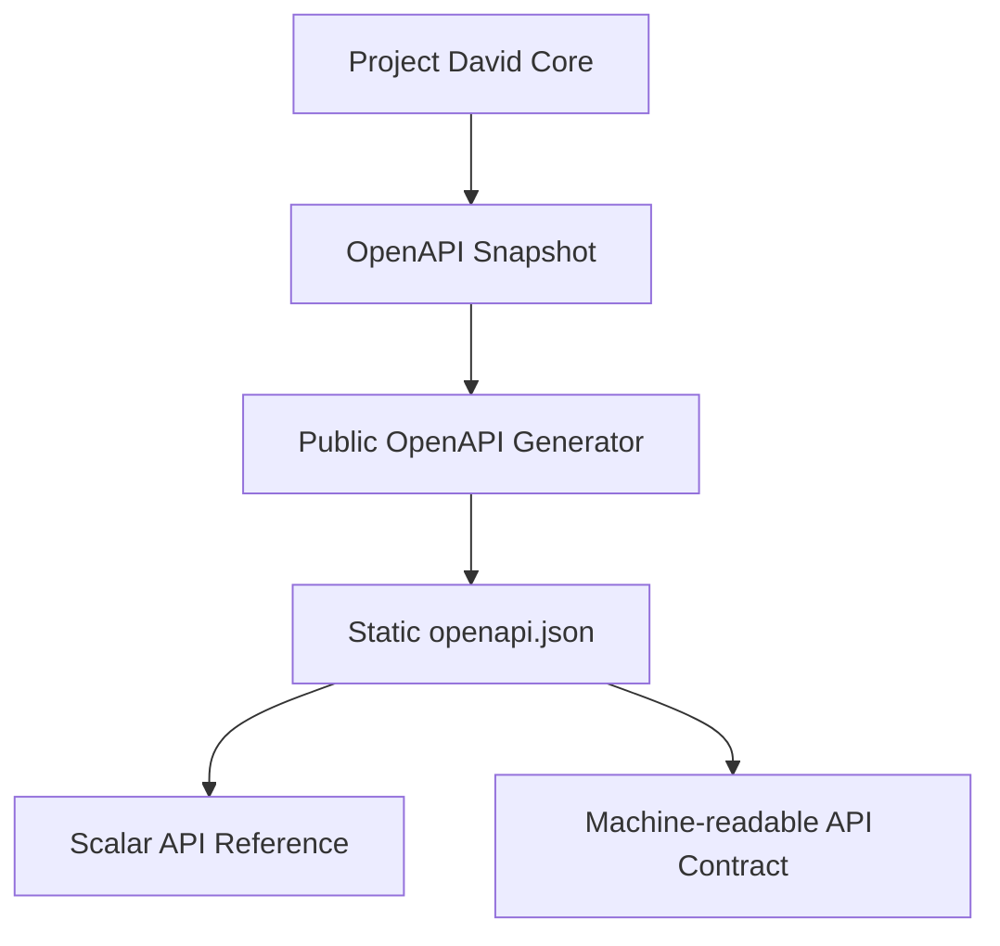

# Public OpenAPI Generation

`generate_public_openapi.py` generates the public Project David API
contract from an authoritative Core OpenAPI snapshot.

## Publication Policy

- Explicit HTTP method and path allowlist (`PUBLIC_GROUPS`).
- New endpoints are excluded until explicitly approved.
- Missing approved endpoints cause generation to fail.
- Operations are grouped into consistent documentation categories.
- Unused component schemas are removed.
- References, operation IDs and authentication declarations are validated.
- Identical inputs produce deterministic output.

Publication filtering is not an authorization mechanism.
Core remains responsible for runtime access control.

## Extract the Core Contract

Run against the verified Core release candidate:

```powershell
docker exec fastapi_cosmic_catalyst python -c "import urllib.request; from pathlib import Path; Path('/tmp/core-openapi.json').write_bytes(urllib.request.urlopen('http://127.0.0.1:9000/openapi.json').read())"

docker cp "fastapi_cosmic_catalyst:/tmp/core-openapi.json" "$env:TEMP\core-openapi.json"
```

## Generate the Public Contract

From the Core repository root:

```powershell
python scripts/generate_public_openapi.py `
    "$env:TEMP\core-openapi.json" `
    "../projectdavid_docs/public/openapi.json"
```

For production publication, supply `--server` with the verified
public API base URL.

Without this argument, the generated contract is intended for
reference preview only.

## Regression Tests

```powershell
python -m pytest tests/unit/test_public_openapi.py -q
```

## Architecture



The documentation platform consumes the generated static contract
through Scalar. No live Core connection is required to render
the API reference.

## Maintenance

- Core is the authoritative source of API contracts.
- Update `PUBLIC_GROUPS` when approving public API changes.
- Correct schema defects at their source.
- Never manually edit the generated JSON.
- Regenerate and commit the public contract whenever the
  published API changes.
- Review excluded operations before publication.
- Run regression tests before committing generator changes.

## Current Limitations

- Execution Accounting response schemas require further typing.
- Inference authentication is not fully represented in the source
  OpenAPI security declaration.
- Full OpenAPI standards validation remains outstanding.
- Automated CI publication remains outstanding.
